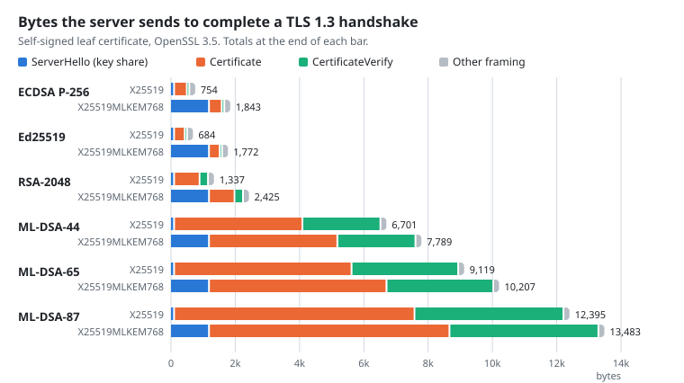
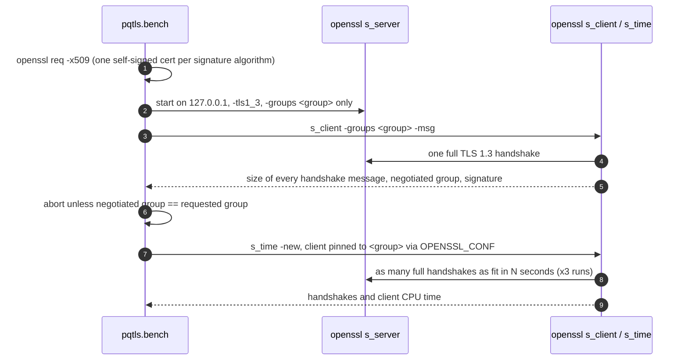

<h1 align="center">pq-tls-lab</h1>

<p align="center">
  <strong>What does post-quantum TLS actually cost?</strong><br>
  Byte-exact measurements of TLS 1.3 handshakes with hybrid <b>X25519MLKEM768</b> key exchange
  and <b>ML-DSA</b> certificates, checked against the standards.
</p>

<p align="center">
  <a href="https://github.com/Danix29/pq-tls-lab/actions/workflows/ci.yml"></a>
  
  
  
  <a href="LICENSE"></a>
</p>

---

## At a glance

<picture>
  <source media="(prefers-color-scheme: dark)" srcset="docs/server-bytes-dark.svg">
  
</picture>

| | Finding | Evidence |
|---|---|---|
| 1 | **Hybrid key exchange is cheap and fixed.** X25519 → X25519MLKEM768 adds **+1,176 B** to the client and **+1,088 B** to the server, whatever the certificate. | Deterministic; asserted against FIPS 203 in the tests |
| 2 | **Certificates are the real cost.** The server sends **754 B** with ECDSA P-256 and **9,119 B** with ML-DSA-65: 12x more, before adding any intermediate CA. | Measured, [table below](#full-results) |
| 3 | **On CPU, the signature change hurts more than the key-exchange change.** Median handshakes/s: 1,267 (ECDSA + X25519) → 1,178 with the hybrid group (−7 %) → 625 with ML-DSA-65 as well (−51 %). | Loopback on a laptop; spread up to 17 %, see [limitations](#limitations) |

In short: the post-quantum key exchange is ready to deploy today; post-quantum *authentication*
is where the bytes are, which is why NIST is still standardizing
[additional signature schemes](https://csrc.nist.gov/projects/pqc-dig-sig) with smaller signatures.

## Contents

- [Quick start](#quick-start)
- [How it works](#how-it-works)
- [Verified against the standards](#verified-against-the-standards)
- [Full results](#full-results)
- [Limitations](#limitations)
- [Repository layout](#repository-layout)
- [Roadmap](#roadmap)
- [References](#references)

## Quick start

Requirements: **OpenSSL 3.5 or newer** and **Python 3.11+**. No Python packages are needed.

```bash
git clone https://github.com/Danix29/pq-tls-lab && cd pq-tls-lab
python -m unittest -v                       # 15 tests: parsers, chart, end-to-end handshakes
python -m pqtls --out results/my-run.json   # full matrix: 6 signatures x 5 groups (~6 min)
```

A quicker comparison of just two certificates and two groups:

```bash
python -m pqtls --sigs ecdsa-p256,mldsa65 --groups X25519,X25519MLKEM768 --seconds 1 --runs 1
```

The harness finds `openssl` through `$PQTLS_OPENSSL`, then `PATH`, then common install
locations (including the copy bundled with Git for Windows), and refuses to run on anything
older than 3.5. To redraw the chart from your own results:
`python -m pqtls.plot results/my-run.json docs/`.

## How it works



Design choices worth knowing:

- **Both ends offer a single group**, so there is no HelloRetryRequest and nothing to negotiate.
  The parser refuses any handshake where a message appears twice.
- **`s_time` has no `-groups` flag**, so the client is pinned through an OpenSSL config file
  (`system_default` → `Groups = <group>`). A negative-control test checks that a client pinned
  to the wrong group completes zero handshakes, so the throughput numbers cannot silently come
  from a different group.
- **One combination at a time**, so servers never compete for the CPU.
- **Asynchronous orchestration** (`asyncio` subprocesses) with timeouts on every OpenSSL call.

## Verified against the standards

The integration tests compare the bytes on the wire with sizes fixed by the specifications,
not with previous runs:

| What is checked | Expected | Source |
|---|---|---|
| ServerHello grows by the ML-KEM-768 ciphertext | **+1,088 B** | FIPS 203 (Table 3), RFC 10024 |
| ClientHello grows by the ML-KEM-768 encapsulation key | **+1,184 B** − 8 B ¹ | FIPS 203 (Table 3), RFC 10024 |
| CertificateVerify carries an ML-DSA-44 / 65 / 87 signature | **2,420 / 3,309 / 4,627 B** + 8 B framing | FIPS 204 (Table 2) |
| The negotiated group is the requested one, for every row | exact match | `s_client` output |

¹ OpenSSL sends the 8-byte `ec_point_formats` extension only when a pure ECDHE group is
offered, so offering X25519MLKEM768 alone saves those 8 bytes. Found with `s_client -trace`.

CI runs the whole suite on Alpine Linux with OpenSSL 3.5 on every push and fails, instead of
skipping, if OpenSSL is older than 3.5.

## Full results

First full run: 11 Nov 2026 · Windows 11 laptop (Intel, family 6 model 183) · OpenSSL 3.5.6
(Git for Windows) · Python 3.11.9 · 3 runs × 3 s per pair.
Raw data: [`results/windows-openssl-3.5.6.json`](results/windows-openssl-3.5.6.json).

<details>
<summary><b>All 30 combinations</b> (sizes in bytes, including the 4-byte handshake header)</summary>

| Signature | Group | ClientHello | ServerHello | Certificate | CertificateVerify | Client sent | Server sent | Handshakes/s (median) | Client CPU ms/hs (median) |
|---|---|--:|--:|--:|--:|--:|--:|--:|--:|
| ecdsa-p256 | X25519 | 219 | 122 | 397 | 78 | 304 | 754 | 1267.2 | 0.236 |
| ecdsa-p256 | secp256r1 | 252 | 155 | 397 | 80 | 337 | 789 | 1248.0 | 0.260 |
| ecdsa-p256 | X25519MLKEM768 | 1395 | 1210 | 397 | 79 | 1480 | 1843 | 1178.0 | 0.325 |
| ecdsa-p256 | SecP256r1MLKEM768 | 1428 | 1243 | 397 | 78 | 1513 | 1875 | 845.8 | 0.419 |
| ecdsa-p256 | MLKEM768 | 1363 | 1178 | 397 | 79 | 1448 | 1811 | 1161.4 | 0.220 |
| ed25519 | X25519 | 219 | 122 | 333 | 72 | 304 | 684 | 1240.8 | 0.232 |
| ed25519 | secp256r1 | 252 | 155 | 333 | 72 | 337 | 717 | 1171.5 | 0.227 |
| ed25519 | X25519MLKEM768 | 1395 | 1210 | 333 | 72 | 1480 | 1772 | 1099.6 | 0.301 |
| ed25519 | SecP256r1MLKEM768 | 1428 | 1243 | 333 | 72 | 1513 | 1805 | 1003.5 | 0.294 |
| ed25519 | MLKEM768 | 1363 | 1178 | 333 | 72 | 1448 | 1740 | 1343.5 | 0.234 |
| rsa-2048 | X25519 | 219 | 122 | 794 | 264 | 304 | 1337 | 900.0 | 0.146 |
| rsa-2048 | secp256r1 | 252 | 155 | 794 | 264 | 337 | 1370 | 848.2 | 0.230 |
| rsa-2048 | X25519MLKEM768 | 1395 | 1210 | 794 | 264 | 1480 | 2425 | 558.8 | 0.383 |
| rsa-2048 | SecP256r1MLKEM768 | 1428 | 1243 | 794 | 264 | 1513 | 2458 | 658.7 | 0.362 |
| rsa-2048 | MLKEM768 | 1363 | 1178 | 794 | 264 | 1448 | 2393 | 738.0 | 0.236 |
| mldsa44 | X25519 | 219 | 122 | 3994 | 2428 | 304 | 6701 | 830.8 | 0.352 |
| mldsa44 | secp256r1 | 252 | 155 | 3994 | 2428 | 337 | 6734 | 810.2 | 0.369 |
| mldsa44 | X25519MLKEM768 | 1395 | 1210 | 3994 | 2428 | 1480 | 7789 | 789.2 | 0.340 |
| mldsa44 | SecP256r1MLKEM768 | 1428 | 1243 | 3994 | 2428 | 1513 | 7822 | 758.2 | 0.349 |
| mldsa44 | MLKEM768 | 1363 | 1178 | 3994 | 2428 | 1448 | 7757 | 846.5 | 0.289 |
| mldsa65 | X25519 | 219 | 122 | 5523 | 3317 | 304 | 9119 | 657.8 | 0.310 |
| mldsa65 | secp256r1 | 252 | 155 | 5523 | 3317 | 337 | 9152 | 646.0 | 0.365 |
| mldsa65 | X25519MLKEM768 | 1395 | 1210 | 5523 | 3317 | 1480 | 10207 | 625.0 | 0.391 |
| mldsa65 | SecP256r1MLKEM768 | 1428 | 1243 | 5523 | 3317 | 1513 | 10240 | 605.8 | 0.433 |
| mldsa65 | MLKEM768 | 1363 | 1178 | 5523 | 3317 | 1448 | 10175 | 657.8 | 0.404 |
| mldsa87 | X25519 | 219 | 122 | 7481 | 4635 | 304 | 12395 | 577.2 | 0.429 |
| mldsa87 | secp256r1 | 252 | 155 | 7481 | 4635 | 337 | 12428 | 638.0 | 0.415 |
| mldsa87 | X25519MLKEM768 | 1395 | 1210 | 7481 | 4635 | 1480 | 13483 | 615.2 | 0.398 |
| mldsa87 | SecP256r1MLKEM768 | 1428 | 1243 | 7481 | 4635 | 1513 | 13516 | 579.8 | 0.509 |
| mldsa87 | MLKEM768 | 1363 | 1178 | 7481 | 4635 | 1448 | 13451 | 636.0 | 0.389 |

"Client sent" / "Server sent" are the TLS bytes in each direction until the handshake completes.

</details>

## Limitations

Read these before quoting a number from this repository.

- **Loopback on one machine.** Client and server share a CPU and there is no network delay or
  loss, so throughput reflects CPU cost only. Over a real network the extra bytes matter more.
- **Self-signed leaf only.** Real chains include at least one intermediate certificate, so a
  real ML-DSA chain is bigger than measured here. Back-of-the-envelope, not measured: one
  ML-DSA-65 intermediate adds about 5.5 KB, taking the server's flight above 14.6 KB, the
  10-segment initial congestion window of RFC 6928 with a 1,460-byte MSS. Whether that costs an
  extra round trip depends on the TCP stack and the network; that is the next thing to measure.
- **Throughput is noisy on a laptop.** Run-to-run spread reaches 17 % in some rows (Ed25519 +
  X25519MLKEM768: 978 to 1,146 handshakes/s), so differences of about 10 % or less mean
  nothing here. The client-CPU column is an order of magnitude, not a precise figure.
- **Wall time includes process start-up** (a few ms per multi-second run), because `s_time`
  reports whole seconds only.
- **ECDSA sizes move by a byte or two** between runs, because DER-encoded ECDSA signatures have
  variable length. ML-DSA, Ed25519 and RSA sizes are fixed.
- **The harness does not load your own OpenSSL configuration** for the `s_time` runs.
- CI checks that everything builds and runs; it makes no performance claims.

## Repository layout

```text
pqtls/
  openssl.py     find OpenSSL >= 3.5, run it asynchronously with timeouts
  certs.py       self-signed credentials for each signature algorithm
  handshake.py   s_server / s_client orchestration and the -msg parser
  latency.py     s_time throughput with the client pinned to one group
  bench.py       CLI: the measurement matrix, JSON and Markdown output
  plot.py        SVG charts from a results file (standard library only)
tests/           unit tests and end-to-end checks against FIPS 203/204
results/         raw results of each published run
docs/            generated charts
```

## Roadmap

- [x] Per-message handshake sizes and throughput, 6 signatures x 5 groups
- [x] Size checks against FIPS 203/204, negative control for group pinning, CI on Linux
- [ ] Certificate chains with an intermediate CA
- [ ] Packet captures (pcap) per handshake, for inspection in Wireshark
- [ ] Real-network conditions (RTT, loss) in containers, to test the congestion-window question
- [ ] A Rust client on rustls, to compare implementations

## References

1. NIST, **FIPS 203**, *Module-Lattice-Based Key-Encapsulation Mechanism Standard*, Aug 2024. https://csrc.nist.gov/pubs/fips/203/final
2. NIST, **FIPS 204**, *Module-Lattice-Based Digital Signature Standard*, Aug 2024. https://csrc.nist.gov/pubs/fips/204/final
3. IETF, **RFC 10024**, *Post-Quantum Traditional (PQ/T) Hybrid Key Agreement Mechanisms for TLS 1.3*, Aug 2026. https://datatracker.ietf.org/doc/rfc10024/
4. IETF, **draft-ietf-tls-mldsa**, *Use of ML-DSA in TLS 1.3*. https://datatracker.ietf.org/doc/draft-ietf-tls-mldsa/
5. IETF, **RFC 8446**, *The Transport Layer Security (TLS) Protocol Version 1.3*. https://www.rfc-editor.org/rfc/rfc8446
6. IETF, **RFC 6928**, *Increasing TCP's Initial Window*. https://www.rfc-editor.org/rfc/rfc6928
7. OpenSSL, **3.5 release notes** (ML-KEM, ML-DSA, SLH-DSA; X25519MLKEM768 in the default key shares). https://github.com/openssl/openssl/blob/openssl-3.5/NEWS.md

Background notes on the standards: [pqc-notes](https://github.com/Danix29/pqc-notes).

## Security and license

This is a measurement lab, not a TLS implementation; see [SECURITY.md](SECURITY.md).
Code under the [MIT license](LICENSE). If you use the numbers, please cite the repository
([CITATION.cff](CITATION.cff)).
